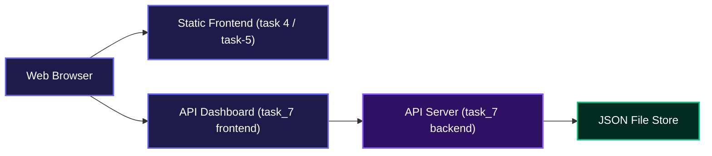
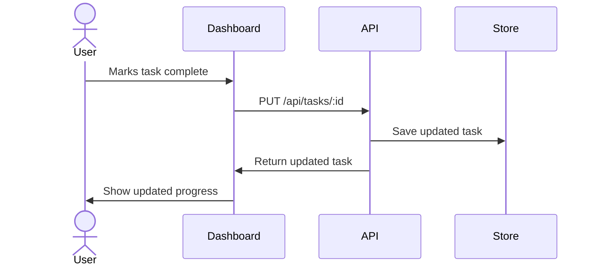

# TechBridge Frontend Internship Experiences

A collection of polished, interactive web experiences for TechBridge, a practical learning platform that helps learners turn theory into real-world skills.

## Overview

TechBridge Frontend Experiences gives learners a clear, engaging way to explore what the platform offers. It includes a 30-day internship roadmap, an interactive challenge hub with a personal intern dashboard, and a task management API with a connected dashboard for tracking progress. The focus is on making the learning journey feel organized, approachable, and easy to navigate.

## System Design

The project is split into static frontend experiences and a small full-stack task API. Static pages run directly in the browser, while the API dashboard loads and saves task data through a backend server that persists everything to a JSON file.



## Usage

You can view the experiences directly in a browser by opening the HTML files.

### Internship Roadmap

Open `task 4/index.html` to see the 30-day internship roadmap.

- Click the **Data Analytics** or **Web Development** buttons to switch tracks.
- Browse each task card to see the day, title, difficulty, and description.
- Use the navigation to jump to the roadmap or contact the team.

### Challenge Hub

Open `task-5/index.html` to explore practical challenges.

- Use the **TRACK** filter to show only Data Analytics or Web Development challenges.
- Use the **DIFFICULTY** filter to focus on Beginner, Intermediate, or Advanced challenges.
- Type in the search box to find a challenge by name or topic.
- Click **View challenge** on any card to open a details modal with objectives, skills, tools, and deliverables.

### Intern Dashboard

Open `task-5/dashboard.html` to see the intern dashboard.

- Review the progress bar and summary cards showing completed, in-progress, and remaining tasks.
- Filter tasks by status using the tabs, or search by keyword.
- Click **View task** to open task details and mark tasks as completed.
- Switch technology tabs to read about Next.js, Vue.js, Angular, and backend development.

### Task Management API

Open a terminal in the `task_7/backend` folder and run:

```bash
cd task_7/backend
bun install
bun run dev
```

Then open:

- Dashboard: http://localhost:3000/dashboard.html
- All tasks: http://localhost:3000/api/tasks
- API health: http://localhost:3000/api/health

The backend also serves the frontend, so you do not need a separate frontend server or CORS configuration.

On Windows, you can also double-click `task_7/RUN-WINDOWS.bat`.

## Features

### Internship Roadmap

- **Interactive Track Switching:** Switch between Data Analytics and Web Development roadmaps with smooth updates to task cards and progress indicators.

### Challenge Hub

- **Dynamic Challenge Filtering:** Filter challenges by track, difficulty, and live search; reset all filters with one click.

### Intern Dashboard

- **Progress Tracking:** Visual progress bar and summary cards update as tasks are completed.
- **Task Filtering and Search:** Filter by All, Completed, In Progress, or Not Started; search tasks by title, description, or keyword.
- **Task Detail Modal:** View task details and mark tasks as completed directly from the modal.
- **Technology Explorer:** Browse tabs for Next.js, Vue.js, Angular, and backend development with descriptions and learning links.

### Task Management API

- **RESTful Task API:** Create, read, update, and delete internship tasks through a backend API.
- **Persistent Storage:** Task data is saved to a JSON file, so changes survive server restarts.
- **Connected Dashboard:** The dashboard fetches live task data, shows loading and error states, and reflects updates instantly.
- **Progress Sync:** Marking a task complete updates the backend and refreshes progress stats.



## API Documentation

The Task Management API runs on the port set by the `PORT` environment variable, or `3000` by default.

### Environment Variables

| Variable | Required | Default | Purpose |
| -------- | -------- | ------- | ------- |
| `PORT` | No | `3000` | Port the server listens on |

### Endpoints

| Method | Endpoint | Purpose |
| ------ | -------- | ------- |
| GET | `/api/health` | Check whether the API is running |
| GET | `/api/tasks` | Return all internship tasks |
| GET | `/api/tasks/:id` | Return one task by ID |
| PUT | `/api/tasks/:id` | Update a task's status |
| POST | `/api/tasks` | Create a new task |
| DELETE | `/api/tasks/:id` | Delete a task |

### Examples

Check API health:

```bash
curl http://localhost:3000/api/health
```

Response:

```json
{
  "success": true,
  "message": "TechBridge Task Management API is running",
  "timestamp": "2026-11-20T12:00:00.000Z"
}
```

Update a task status:

```bash
curl -X PUT http://localhost:3000/api/tasks/3 \
  -H "Content-Type: application/json" \
  -d '{"status": "completed"}'
```

Allowed statuses: `not-started`, `in-progress`, `completed`.

Create a task:

```bash
curl -X POST http://localhost:3000/api/tasks \
  -H "Content-Type: application/json" \
  -d '{
    "title": "Build a portfolio",
    "description": "Create and publish a personal developer portfolio."
  }'
```

## Technologies Used

| Technology | Purpose |
| ---------- | ------- |
| [HTML](https://developer.mozilla.org/en-US/docs/Web/HTML) | Page structure and semantic markup |
| [CSS](https://developer.mozilla.org/en-US/docs/Web/CSS) | Styling, layout, animations, and responsiveness |
| [JavaScript](https://developer.mozilla.org/en-US/docs/Web/JavaScript) | Interactivity, filtering, modals, and dynamic rendering |
| [TypeScript](https://www.typescriptlang.org/) | Type-safe backend code for the task API |
| [Express](https://expressjs.com/) | Backend API server for task management |
| [Bun](https://bun.sh/) / [Node.js](https://nodejs.org/) | Runtime for the backend server |
| [Google Fonts](https://fonts.google.com/) | Typography |

## Author

Built by the TechBridge frontend developer as part of the practical internship program.

## Badges

[](https://developer.mozilla.org/en-US/docs/Web/HTML)
[](https://developer.mozilla.org/en-US/docs/Web/CSS)
[](https://developer.mozilla.org/en-US/docs/Web/JavaScript)

[](https://dokugen.samueltuoyo.com)